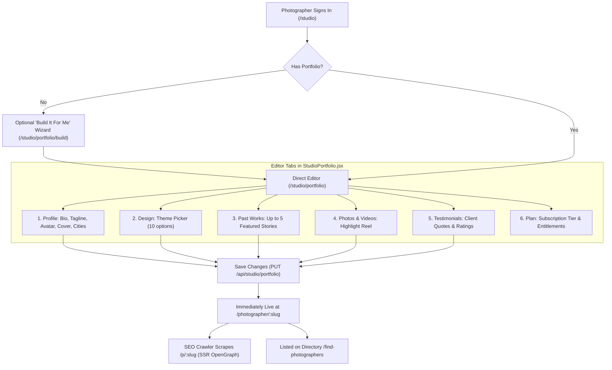

# Astra Context: Photographer Portfolio System Audit & Redesign Brief

**Document Version:** 1.0.0  
**Date:** October 11, 2026  
**Target Audience:** Astra & Lead Engineering Team  
**Scope:** MAJA Invites / Pixora Photographer Portfolio Websites (`/photographer/:slug`)  
**Status:** Read-Only Audit Complete — Ready for Architecture & Design Iteration  

---

## 1. Executive Summary & Problem Statement

### 1.1 What the Feature Is
In **MAJA Invites / Pixora**, wedding and event photographers receive a dedicated public-facing portfolio website hosted at:
```
https://<domain>/photographer/<studio-slug>
```
(and server-rendered SEO landing route `/p/<studio-slug>`).

This feature is designed as a standalone digital storefront for professional photographers to showcase their brand identity, past wedding stories, highlight galleries, service packages, client testimonials, and capture inquiries.

> [!IMPORTANT]
> **Scope Distinction:**
> - **In Scope:** The photographer portfolio website builder (`/photographer/:slug`, `/studio/portfolio`, `/portfolio-samples`).
> - **Out of Scope:** Maneesh's personal developer portfolio (`/about-developer`), wedding guest digital invitation cards (`/invitation/:slug`), and client photo delivery galleries (`/gallery/:slug`).

### 1.2 The Problem: Why the Owner is Dissatisfied
1. **The "10 Themes" are an Illusion:** Although `portfolioDesigns.js` declares 10 distinct design names across Free, Basic, and Premium tiers, **9 of the 10 designs share the exact same DOM tree, layout, and component structure**. They are merely tokenized CSS color-palette swaps.
2. **The 10th Design is Broken in Production:** The flagship design (`premium_editorial`) was originally built in legacy v1 as an asymmetric 12-column editorial layout, but was never ported to `frontend-v2`. Instead, `PhotographerPublic.jsx` renders a fallback notice:
   > *"This studio’s chosen editorial layout isn’t available on this viewer yet — showing MAJA’s default premium theme instead."*
3. **Dead Code Motifs & Features:** Attributes like `signature: 'filmstrip'`, `'grain'`, `'sunlight'`, `'glass'`, `'aurora'` and `depth: true` exist in config but have zero CSS or JS implementation. No film strips, noise textures, or 3D scroll effects render.
4. **Poor Photo Presentation:** Photos are forced into a rigid, uniform 4:5 aspect ratio CSS grid (`repeat(auto-fill, minmax(160px, 1fr))`). Landscape orientations are severely cropped, tall portraits are clipped, and clicking a photo does not open a full-screen lightbox or slideshow.
5. **Generic "Social Profile" Header:** The hero section uses a 30vh banner with a negative-margin avatar chip (`-64px`), making a luxury wedding photographer look like a generic social media bio page rather than an elite editorial artist.
6. **Inquiry & Conversion Disconnection:** While the backend has an inquiry pipeline (`portfolio_leads.py`), the public frontend only renders static pill links (`tel:`, `mailto:`, `wa.me`). There is no embedded inquiry form, date checker, or package inquiry modal.

---

## 2. Architecture & Code Map

### 2.1 File Map
```
c:\my projects\maja invites\maja_invites-main\
├── frontend-v2\
│   └── src\
│       ├── pages\
│       │   ├── PhotographerPublic.jsx          # Public portfolio renderer (/photographer/:slug)
│       │   ├── PhotographerPublic.css          # Public portfolio styles & theme token definitions
│       │   ├── StudioPortfolio.jsx             # Photographer management editor (/studio/portfolio)
│       │   ├── StudioPortfolio.css             # Editor styles (6 tabs)
│       │   ├── StudioPortfolioBuild.jsx        # "Build It For Me" 3-step wizard (/studio/portfolio/build)
│       │   └── PortfolioSamples.jsx            # Public preview samples directory (/portfolio-samples)
│       ├── components\studio\
│       │   ├── PortfolioGallery.jsx            # Media asset manager (photos, videos, captions)
│       │   └── StudioShowcase.jsx              # Service packages display component
│       └── lib\
│           └── portfolioDesigns.js             # Catalog of 10 designs, colors, typography, tiers
│
├── backend\
│   ├── portfolio_service.py                   # Business logic, profile updates, slug resolution
│   ├── portfolio_seo.py                       # SSR meta tag generation, OpenGraph, JSON-LD schema
│   ├── portfolio_leads.py                     # Lead generation & inquiry tracking engine
│   └── server.py                              # FastAPI routing & endpoint definitions
│
└── legacy\ (frontend\src\portfolioLayouts\)
    └── premiumEditorial.jsx                   # Unported legacy v1 asymmetric 12-column template
```

### 2.2 Key API Surface
| Endpoint | Method | Auth | Description |
|---|---|---|---|
| `/api/public/photographer/{slug}/portfolio` | `GET` | Public | Returns complete public studio profile, active design, past works, testimonials, packages, and verification badge. |
| `/api/public/photographer/{slug}/seo` | `GET` | Public | Returns OpenGraph title, description, cover image, and Schema.org `LocalBusiness` JSON-LD. |
| `/api/public/photographer/{slug}/inquire` | `POST` | Public | Ingests a wedding inquiry (name, phone, event date, venue, message) for the studio. |
| `/api/studio/portfolio` | `GET` | Studio JWT | Fetches authenticated photographer's editable portfolio document. |
| `/api/studio/portfolio` | `PUT` | Studio JWT | Updates profile fields, design ID, works, testimonials, and gallery assets. |
| `/p/{slug}` | `GET` | Public | Prerendered HTML landing route with rich bot meta tags before SPA hydration. |

---

## 3. Photographer Workflow



### 3.1 Draft vs. Published State
- **There is NO draft staging environment.** Every change saved in `/studio/portfolio` directly updates the live MongoDB record in `portfolio_profiles`.
- Switching designs takes effect immediately upon page reload at `/photographer/:slug`.
- Switching designs **never deletes photographer data**. The data payload (works, photos, bio, testimonials) is preserved and re-rendered with the new design ID.

### 3.2 What Photographers Can Customize
- **Studio Identity:** Studio Name, Tagline, Story/Bio, Experience (years), City, State, Service Areas.
- **Visual Assets:** Avatar/Logo image, Hero Cover Banner image.
- **Design Selection:** 1 of 10 design templates (gated by subscription plan).
- **Featured Works:** Up to 5 wedding projects (Title, Couple Name, Date, Location, Cover photo, Project gallery photos).
- **Highlight Media:** Up to 30 studio photos with tags and captions; video reel URLs (YouTube/Vimeo).
- **Testimonials:** Up to 6 client reviews with couple name, wedding date, text, and rating.
- **Packages & Pricing:** Service packages (Name, Price, Inclusions, Turnaround time).
- **Contact Channels:** Phone, WhatsApp, Email, Instagram handle, Website link.

### 3.3 What Super-Admins Can Configure
- **Verification Badges:** Level 0 (Unverified), Level 1 (Verified Identity), Level 2 (Elite Verified Studio).
- **Plan Overrides:** Force upgrade or bypass subscription gating.
- **Custom Domains:** Host header routing for whitelabeled domains.
- **SEO & Featured Directory Placement:** Pinning high-performing studios to `/find-photographers`.

---

## 4. Complete Design Audit Table (All 10 Designs)

All 10 designs were systematically audited against the unified demo studio (`demo_audit_studio` / `Lumiere Stories Studio`, Udaipur) across Desktop (1280×800) and Mobile (390×844) viewports.

| Design ID | Display Name | Tier | Renderer | Heading Font / Body Font | Background / Accent | Declared Motifs | Visual Reality & Critical Weaknesses | Screenshot Artifacts |
|---|---|---|---|---|---|---|---|---|
| `free_studio_neutral` | Studio Neutral | Free | `PhotographerPublic` (Token Stack) | Inter / Inter | `#FAFAF8` / `#8A8578` | None | Generic, looks like an admin template. Muted greys lack prestige. | `portfolio_audit_free_studio_neutral_desktop.png`<br>`portfolio_audit_free_studio_neutral_mobile_390.png` |
| `basic_golden_hour` | Golden Hour | Basic | `PhotographerPublic` (Token Stack) | Fraunces / Inter | `#F7F3EC` / `#C97B4A` | `sunlight` (dead) | Warm terracotta accents, but layout is 100% identical. Sunlight effect is never drawn. | `portfolio_audit_basic_golden_hour_desktop.png`<br>`portfolio_audit_basic_golden_hour_mobile_390.png` |
| `basic_darkroom` | Monochrome Darkroom | Basic | `PhotographerPublic` (Token Stack) | Archivo Narrow / Inter | `#0F0F0F` / `#B8985E` | `grain` (dead) | Pitch dark background. Sub-headers have poor contrast. Film grain effect is never drawn. | `portfolio_audit_basic_darkroom_desktop.png`<br>`portfolio_audit_basic_darkroom_mobile_390.png` |
| `basic_nordic` | Nordic Light | Basic | `PhotographerPublic` (Token Stack) | Jost / Jost | `#F5F6F4` / `#8FA89C` | `horizon` (dead) | Clean pale sage palette, but layout has zero Scandinavian minimalism flair; identical DOM stack. | `portfolio_audit_basic_nordic_desktop.png`<br>`portfolio_audit_basic_nordic_mobile_390.png` |
| `premium_gallery_wall` | Gallery Wall | Premium | `PhotographerPublic` (Token Stack) | Fraunces / Inter | `#EFEDE6` / `#9C8F7A` | `gallery`, `depth: true` (dead) | Museum beige. Parallax depth and gallery wall framing are completely absent. | `portfolio_audit_premium_gallery_wall_desktop.png`<br>`portfolio_audit_premium_gallery_wall_mobile_390.png` |
| `premium_film_strip` | Film Strip Cinematic | Premium | `PhotographerPublic` (Token Stack) | Playfair Display / Inter | `#101010` / `#C1272D` | `filmstrip` (dead) | Deep black with crimson accents. Zero film strip perforations or cinematic borders rendered. | `portfolio_audit_premium_film_strip_desktop.png`<br>`portfolio_audit_premium_film_strip_mobile_390.png` |
| `premium_liquid_glass` | Liquid Glass Editorial | Premium | `PhotographerPublic` (Token Stack) | Playfair Display / Inter | `#EDEBE6` / `#B98FA6` | `glass` (dead) | Pale lavender/taupe. No glassmorphism, blur filters, or refraction effects exist in CSS. | `portfolio_audit_premium_liquid_glass_desktop.png`<br>`portfolio_audit_premium_liquid_glass_mobile_390.png` |
| `premium_contact_sheet` | Analog Contact Sheet | Premium | `PhotographerPublic` (Token Stack) | Zilla Slab / Lora | `#DAD5C8` / `#A63B2E` | `contactsheet` (dead) | Newsprint beige and burnt sienna. No contact sheet frames, frame numbers, or wax pencil marks. | `portfolio_audit_premium_contact_sheet_desktop.png`<br>`portfolio_audit_premium_contact_sheet_mobile_390.png` |
| `premium_aurora` | Aurora Portfolio | Premium | `PhotographerPublic` (Token Stack) | Space Grotesk / Space Grotesk | `#0B0B10` / `#B85C8A` | `aurora` (dead) | Dark indigo with magenta accents. No generative aurora gradient mesh or glow effects. | `portfolio_audit_premium_aurora_desktop.png`<br>`portfolio_audit_premium_aurora_mobile_390.png` |
| `premium_editorial` | Premium Editorial | Premium | **Fallback Banner** in `PhotographerPublic` | Cormorant Garamond / Inter | `#F4F1EA` / `#9A6A45` | Custom 12-col (broken) | **Degraded.** Displays apology banner on public site. Custom asymmetric layout unported from v1. | `portfolio_audit_premium_editorial_desktop.png`<br>`portfolio_audit_premium_editorial_mobile_390.png` |

---

## 5. Visual and Layout Critique: Why Current Designs Fail

### 5.1 Structural Uniformity
In `PhotographerPublic.jsx`, lines 164–376, every visitor encounters this inflexible linear stack:
1. Fixed 30vh banner image with bottom gradient fade.
2. Centered avatar circle (-64px overlap) + Studio name + verification badge.
3. 3-metric quick stats row (Years in Business, Featured Works, Highlights).
4. About text paragraph (max-width 65ch).
5. Featured Works grid (2-column card stack).
6. Studio Photos grid (rigid 4:5 aspect ratio cards).
7. Service packages (if configured).
8. Testimonial carousel / cards.
9. Contact pills (Call, WhatsApp, Email, Instagram).
10. Footer with "Powered by MAJA Invites / Pixora".

Because 9 designs share this exact sequence, photographers changing themes perceive zero layout differentiation—only text and background colors shift.

### 5.2 Ruthless Cropping & Lack of Media Experience
- Wedding photography relies heavily on aspect ratio integrity (3:2 horizontal landscapes of ceremonies, 2:3 vertical bridal portraits, wide panoramic venue shots).
- The current implementation enforces:
  ```css
  .pf-photos-grid img {
    aspect-ratio: 4 / 5;
    object-fit: cover;
  }
  ```
  This aggressively chops off brides' veils, grooms' shoes, and wide architectural scenes.
- Clicking a photo does **nothing**. There is no lightbox, no zoom, and no navigation between photos.

### 5.3 Weak Hero Section
- A 30vh hero image banner is too narrow to create an emotional connection.
- A circular avatar overlapping the hero banner is reminiscent of Twitter or LinkedIn, clashing with the high-fashion editorial presence expected by luxury wedding clients.

### 5.4 Underwhelming Conversion Architecture
- High-intent wedding couples visiting a photographer's site want to check date availability, see base pricing, and submit event details.
- Currently, they are only given external links (`wa.me`, `tel:`). There is no inline date picker, no inquiry modal, and no automated lead logging to the studio's dashboard.

---

## 6. Data Model & Field Mapping

### 6.1 MongoDB Collection: `portfolio_profiles`
The primary collection storing portfolio configurations is `portfolio_profiles`.

```typescript
interface PortfolioProfile {
  _id: ObjectId;
  id: string;                     // Matches studio owner ID or studio ID
  slug: string;                   // Unique URL identifier (e.g. "lumiere-stories")
  studio_name: string;            // Business name
  tagline: string;                // Short sub-headline
  bio: string;                    // Extended story / artist statement
  experience_years: number;       // e.g. 8
  city: string;                   // e.g. "Udaipur"
  state: string;                  // e.g. "Rajasthan"
  country?: string;               // e.g. "India"
  service_areas?: string[];       // e.g. ["Jaipur", "Jodhpur", "Goa", "Destination"]
  
  // Visual Branding
  avatar_url: string;             // Logo / Artist portrait
  cover_photo_url: string;        // Hero background image
  design_id: string;              // Chosen theme ID (e.g. "premium_gallery_wall")
  
  // Content Modules
  works: Array<{                  // Up to 5 featured projects
    id: string;
    title: string;                // e.g. "Royal Palace Wedding"
    couple_names: string;         // e.g. "Aanya & Kabir"
    event_date: string;           // ISO date string
    location: string;             // e.g. "City Palace, Udaipur"
    cover_image: string;          // Main preview thumbnail
    photos: Array<{ url: string; caption?: string }>;
  }>;
  
  studio_photos: Array<{          // Highlight gallery (up to 30 items)
    id: string;
    url: string;
    caption?: string;
    category?: string;            // e.g. "Candid", "Traditional", "Bridal"
  }>;
  
  testimonials: Array<{           // Client reviews (up to 6 items)
    id: string;
    client_names: string;         // e.g. "Pooja & Rohan"
    wedding_date: string;
    quote: string;
    rating: number;               // 1 to 5
    photo_url?: string;
  }>;
  
  packages?: Array<{              // Pricing tiers
    id: string;
    name: string;                 // e.g. "Full Wedding & Pre-wedding"
    price: number;
    currency: string;             // e.g. "INR"
    deliverables: string[];
  }>;
  
  social_links: {
    instagram?: string;
    whatsapp?: string;
    phone?: string;
    email?: string;
    website?: string;
  };

  // Badging & Entitlements
  verification_level: 0 | 1 | 2;  // 0: Unverified, 1: ID Verified, 2: Top Tier
  plan_tier: "free" | "basic" | "premium";
  custom_domain?: string;
  is_published: boolean;
  updated_at: string;
}
```

---

## 7. Plan Gates & Entitlements

Configured in `portfolioDesigns.js` and enforced in `portfolio_service.py`:

| Plan Tier | Allowed Themes | Max Featured Works | Max Highlight Photos | Custom Domain | Lead Capture Inbox |
|---|---|---|---|---|---|
| **Free** | `free_studio_neutral` (1) | 2 Works | 6 Photos | ❌ | Basic WhatsApp link |
| **Basic** | Free + 3 Basic (`basic_golden_hour`, `basic_darkroom`, `basic_nordic`) | 3 Works | 15 Photos | ❌ | WhatsApp + Direct Email |
| **Premium** | All 10 Themes (including 6 Premium) | 5 Works | 30 Photos | ✅ (Optional add-on) | Full Lead Inquiry Form & CRM |

### Gating Invariant:
If a photographer downgrades or selects a theme above their tier, the editor must notify them with an upgrade modal, while the public endpoint serves their configured theme gracefully without crashing.

---

## 8. SEO, OpenGraph, Lead Generation, & Directory Connections

### 8.1 Server-Side Prerendering (`/p/:slug`)
- Implemented in `backend/portfolio_seo.py`.
- Generates dynamic HTML tags for social scrapers (WhatsApp, Facebook, Twitter, iMessage):
  - `og:title`: `"{Studio Name} — Wedding Photographer in {City} | MAJA"`
  - `og:description`: `"{Tagline} — View portfolio, wedding stories, and book sessions."`
  - `og:image`: `{cover_photo_url}` (scaled display derivative).
  - `ld+json`: Schema.org `LocalBusiness` and `Photographer` microdata with postal address, price range, and telephone.

### 8.2 Lead Capture Pipeline (`/api/public/photographer/{slug}/inquire`)
- Backend handles:
  - Validates contact details (phone, email).
  - Checks date availability collision against booked dates.
  - Stores lead in `portfolio_leads` collection.
  - Fires WhatsApp / Email notification to studio owner.
- **Frontend Defect:** The public page currently lacks the interactive modal or embedded form to trigger this endpoint! Astra should design this touchpoint into the new layouts.

---

## 9. Technical Constraints & Invariants for Redesign

1. **URL & Route Invariants:**
   - Public route must remain: `/photographer/:slug`.
   - SEO landing route must remain: `/p/:slug`.
   - Studio management route must remain: `/studio/portfolio`.
2. **Backward Compatibility:**
   - Any new layout system **must not break existing studio profiles** in MongoDB. All existing fields (`works`, `studio_photos`, `testimonials`, `social_links`, `verification_level`) must seamlessly render.
3. **No Private/Original Image Leaks:**
   - Original uncompressed photographer master uploads must not be served directly. Always serve CDN/display derivatives with optimized compression.
4. **Responsive Strictness:**
   - Mobile: 390px viewport (iOS Safari / Android Chrome). Touch-friendly touch targets (min 44px).
   - Tablet: 768px–1023px.
   - Desktop: 1024px–1440px+. No horizontal scrollbars.
5. **Clean Performance:**
   - Fast initial paint. Lazy-load non-hero images with native `loading="lazy"`. Lightbox media loaded on demand.

---

## 10. Open Questions & Ambiguities for Maneesh & Astra

1. **Layout Strategy:** Should Astra build **distinct structural layouts** (e.g. 3–4 fundamentally unique page layouts: Editorial Asymmetric, Luxury Fullscreen Hero, Minimalist Grid, Documentary Storyboard) rather than 10 superficial color swaps?
2. **Lightbox Experience:** Should clicking a photo open an immersive darkroom lightbox with full EXIF data and couple details, or a simple swipeable carousel?
3. **Inquiry UI Form:** Should the inquiry form be an inline footer block, a floating sticky action bar, or a dedicated slide-over drawer?
4. **Video Support:** Should highlight reels support embedded native video or YouTube/Vimeo/Instagram embed cards?

---

## 11. Design Brief / Redesign Target for Astra

### Target Aesthetic:
High-end, editorial, luxury wedding photography platforms (similar to Squarespace Editorial, Format, and Pixieset), tailored for Indian & international luxury destination weddings.

### Recommended Direction:
1. **Hero Variety:**
   - *Option A: Fullscreen Cinematic Hero* with high-impact typography and subtle studio crest/monogram.
   - *Option B: Split Editorial Hero* (50% artist story & booking CTA, 50% vertical signature bridal portrait).
   - *Option C: Floating Asymmetric Collage* showcasing 3 key wedding moments simultaneously.
2. **Dynamic Masonry & Aspect Ratio Preservation:**
   - Transition from rigid 4:5 squares to responsive CSS masonry or natural aspect ratio grids with lightbox modal.
3. **Story-Driven Wedding Works:**
   - Elevate "Past Works" from simple thumbnails into narrative wedding chapters (e.g. "The Royal Udaipur Wedding of Aanya & Kabir").
4. **Frictionless Lead Capture:**
   - An elegant, high-converting "Check Availability & Pricing" modal connecting directly to `/api/public/photographer/{slug}/inquire`.
