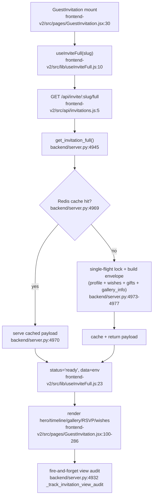
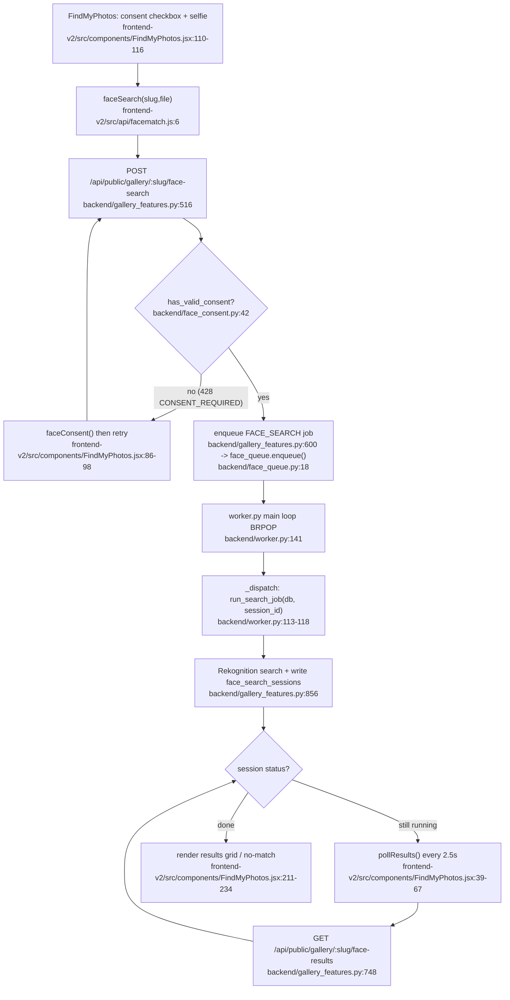
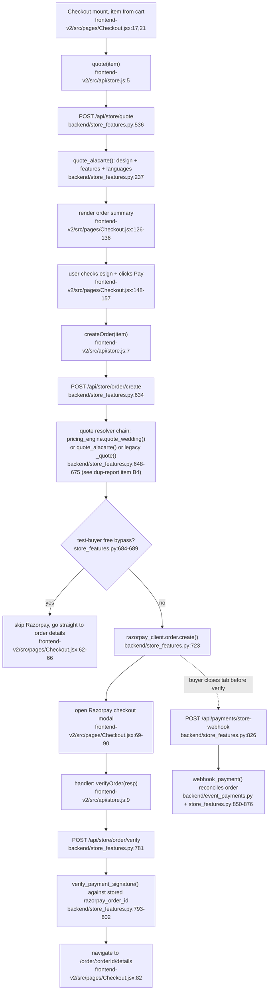

# Pathfinder Phase 0 -- Feature Inventory

Scope: whole repo -- `frontend-v2/` (canonical UI), `backend/` (FastAPI monolith,
`server.py` ~16,470 lines + ~90 router modules), `frontend/` (legacy CRA app,
present but not deployed), `deploy/` (prod stack).

Canonical-UI determination (evidence, not assertion): `deploy/docker-compose.yml:124-129`
mounts only `../frontend-v2/dist` into Caddy's `/srv`; `run.ps1:72-81` only ever
launches `frontend-v2` (vite on :8127) alongside the backend -- the legacy
`frontend/` app is never started by either. `README.md:12` confirms this in
prose: "frontend/ ... fallback ONLY for surfaces not yet ported ... No new
work goes here." Every finding below treats `frontend-v2` as the live surface
and `frontend` as dormant source still in the tree.

---

## 1. Marketing site

Public, unauthenticated pages selling the product.

- Entry: `frontend-v2/src/App.jsx:74-79` (`/`, `/pricing`, `/features`,
  `/how-it-works`, `/faq`, `/contact`)
- Core files: `frontend-v2/src/pages/Landing.jsx` (bespoke nav, `Landing.jsx:80`),
  `Pricing.jsx`, `Features.jsx`, `HowItWorks.jsx`, `Faq.jsx`,
  `Contact.jsx`; shared chrome `frontend-v2/src/components/nav/MarketingNav.jsx:15`
- Pricing.jsx is live-priced: fetches `/api/store/catalog` /
  `/api/store/packages` (`frontend-v2/src/api/store.js:13,17`) --
  `frontend-v2/src/pages/Pricing.jsx:14` ("only prices what the backend
  actually prices"). Landing.jsx and Faq.jsx instead hardcode marketing-copy
  prices (see `02-duplication-report.md` item B).
- Backend: no dedicated router: package/catalog reads come from
  `backend/store_features.py:498` (`/api/store/packages`) and `:513`
  (`/api/store/catalog`).

## 2. Auth (three-plus identities)

CLAUDE.md documents three personas; the repo actually implements **four**
independent token/session mechanisms.

| Identity | Storage | Frontend | Backend |
|---|---|---|---|
| admin / photographer / studio | Bearer JWT in `localStorage.admin_token` | `frontend-v2/src/context/AuthContext.jsx:13-135` | `backend/auth.py:211` `get_current_admin`, `:332` `require_admin` |
| couple / buyer (self-serve) | httpOnly cookie `user_session_token` | `frontend-v2/src/context/UserAuthContext.jsx:21-86` | `backend/user_auth.py:76` `build_user_auth_router`, cookie set at `user_auth.py:137-142` |
| super-admin | role check on the admin JWT (not a separate token) | reuses `AuthContext` | `backend/auth.py:317` `require_super_admin` |
| event/studio-client (Couple Access portal) | Bearer JWT in `localStorage.client_token`, separate axios instance | `frontend-v2/src/lib/clientAuth.js:16-45` (plain module, not a React context) | `backend/auth.py:169` `get_current_event_client`, `:156` `create_client_token`; login at `backend/photographer_clients.py:254` |

- Guard components: `frontend-v2/src/components/RouteGuards.jsx:17`
  (`RequireStudio`), `:32` (`RequireUser`).
- Hybrid "buyer" dependency for store/checkout accepts EITHER the user
  cookie OR the admin bearer token: `backend/server.py:15289`
  `get_current_buyer`.
- Shared axios client with single-flight 401 refresh (admin identity only):
  `frontend-v2/src/api/client.js:44-85`.
- See `02-duplication-report.md` item E for the couple-vs-client-portal
  identity split.

## 3. Invitation delivery (guest / ceremony / save-the-date)

- Entry: `frontend-v2/src/App.jsx:85,86,88,89` -- `/invite/:slug`,
  `/invite/:slug/live-gallery`, `/invite/:slug/:eventType`,
  `/save-the-date/:slug`
- Core files: `frontend-v2/src/pages/GuestInvitation.jsx:30` (full envelope
  view), `frontend-v2/src/pages/CeremonyInvitation.jsx:16` (per-ceremony
  view), shared data hooks `frontend-v2/src/lib/useInviteFull.js:10` and
  `frontend-v2/src/lib/useEventInvitation.js:22`, api client
  `frontend-v2/src/api/invitations.js`.
- Backend: THREE parallel view endpoints exist for essentially the same
  concern:
  - `backend/server.py:4913` `GET /invite/{slug}` (single record)
  - `backend/server.py:4945` `GET /invite/{slug}/full` (batched envelope --
    what GuestInvitation/CeremonyInvitation actually use)
  - `backend/server.py:5332` `GET /invite/{slug}/{event_type}` (per-ceremony,
    what `StudioProfileQrCodes.jsx`-issued QR codes point at --
    `frontend-v2/src/api/invitations.js:18`)
  - `backend/server.py:5502` `GET /invite/{slug}/event/{event_slug}`
    ("PHASE 17") -- grepped across both frontends
    (`frontend-v2/src`, `frontend/src`), **no caller found in either app**;
    dead endpoint.
  - A wholly separate viewer system also exists:
    `backend/invitation_v2.py:1-23` ("Invitation Viewer V2 ... long-scroll
    ... Routes are all prefixed with /api/v2"), mounted at
    `backend/server.py:15686`. No frontend (`frontend-v2` or `frontend`)
    references `/api/v2` or `viewer_v2` anywhere -- confirmed by repo-wide
    grep. Fully orphaned backend feature.
- Legacy fallback: `frontend/src/pages/GeneratedInvitationRoute.jsx:1-5`
  wraps the 1,901-line `frontend/src/pages/LuxuryPublicInvitation.jsx`,
  which independently calls the SAME `/api/invite/{slug}/full` endpoint via
  a raw inline `axios.get` (`frontend/src/pages/LuxuryPublicInvitation.jsx:132`)
  instead of a shared hook. See `02-duplication-report.md` item D.

### Flowchart: invitation view (guest, happy path)

## 4. Live gallery + WebSocket

- Entry: `frontend-v2/src/App.jsx:86` `/invite/:slug/live-gallery` ->
  `frontend-v2/src/pages/LiveGallery.jsx:3` re-exports
  `frontend-v2/src/pages/LivePhotoWall.jsx:54`
- Core files: `frontend-v2/src/pages/LivePhotoWall.jsx` (WS client + poll
  fallback, `wsUrl` at `:16-20`, WS connect at `:163-203`), gallery access
  gate `frontend-v2/src/lib/galleryAccess.js`, api client
  `frontend-v2/src/api/gallery.js`.
- Backend is split across **three** modules for what the frontend treats as
  one feature:
  - `backend/live_gallery_features.py:180` `@router.websocket("/api/ws/gallery/{wedding_id}")`
    (real-time push), `:321` guest upload endpoint (writes `db.live_gallery_photos`)
  - `backend/premium_features.py:597` `GET /invite/{slug}/live-gallery`
    (the wall's poll/read endpoint, reads `db.live_photos`), `:676`
    `POST /invite/{slug}/live-gallery/favorite`
  - `backend/live_wall_feed.py:1-28` -- an explicit reconciliation shim,
    documented in its own docstring as a bug fix for exactly this split
    (see `02-duplication-report.md` item A/dup-1, the top-ranked finding).
- Face-search-from-the-wall entry: `frontend-v2/src/components/FindMyPhotos.jsx`
  (section 5 below), launched from `LivePhotoWall.jsx:497-503`.

## 5. Face match pipeline (queue, worker, consent)

- Entry (UI): `frontend-v2/src/components/FindMyPhotos.jsx:11` (modal,
  intro -> matching -> results/no-match/failed states)
- Api client: `frontend-v2/src/api/facematch.js:6-39`
- Backend synchronous entry: `backend/gallery_features.py:516`
  `POST /public/gallery/{slug}/face-search`, consent-gated by
  `backend/face_consent.py:42` `has_valid_consent` (documented enforcement
  point per `face_consent.py:5-8`).
- Queue contract: `backend/face_queue.py:18` `enqueue()` (Redis LPUSH via
  `cache_backend.queue_push`; no-op/False if no `REDIS_URL`).
- Async consumer: `backend/worker.py:136` `main()` loop -- BRPOP via
  `queue_pop_blocking` (`worker.py:141`), dispatch at `worker.py:104`
  `_dispatch()`, retries with exponential backoff up to `MAX_ATTEMPTS=5`
  (`worker.py:47,124-131`), gives up and records the failure on the
  session/photo doc at `worker.py:83-101`.
- Same job bodies run either inline (no queue configured) or via the
  worker -- both paths call `index_photo_job` / `run_search_job`, imported
  once at `worker.py:45` from `gallery_features.py`. This is a documented,
  deliberate single-code-path design (`worker.py:5-7`), not duplication.

### Flowchart: face match search (happy path)

## 6. Store / money (orders, Razorpay, webhook)

- Entry: `frontend-v2/src/App.jsx:90,91` `/cart`, `/checkout` ->
  `frontend-v2/src/pages/Cart.jsx`, `frontend-v2/src/pages/Checkout.jsx:17`
- Api client: `frontend-v2/src/api/store.js` (`quote`, `createOrder`,
  `verifyOrder`)
- Backend money surface: `backend/store_features.py:430`
  `build_store_router`, `:536` `POST /api/store/quote`, `:634`
  `POST /api/store/order/create`, `:781` `POST /api/store/order/verify`,
  webhook fallback `:826` `POST /api/payments/store-webhook`.
- Price/package resolution: `create_order()` tries THREE resolvers in a
  fallback chain -- flag-gated `backend/pricing_engine.py:381`
  `quote_wedding()`, then the live default
  `backend/store_features.py:237` `quote_alacarte()` (DB-overridable via
  `db.store_features` / `db.store_languages`, `store_features.py:83-84`),
  then legacy `backend/store_features.py:341` `_quote()` keyed off the
  `PACKAGES`/`ADDONS` dicts (`store_features.py:49-63`, still the live
  fallback for the informational `/api/store/packages` catalogue at
  `store_features.py:498`). Full chain at `store_features.py:648-675`;
  see `02-duplication-report.md` item B4.
- A **second, parallel purchase engine** exists in the backend for the
  "Dynamic Event Engine" (`event_*.py` modules): `backend/event_payments.py`
  (order-create + signature-verify + webhook-verify helper, explicitly
  built to be "the ONE Razorpay surface for events" --
  `event_payments.py:2`), `backend/event_purchase_service.py:171`
  `webhook_purchase`, `backend/event_finance_service.py:279`
  (independent `order.create`). This entire path is wired ONLY to the
  legacy frontend's `/events`, `/events/:eventId/builder` routes
  (`frontend/src/App.js:400-401`, pages `EventsDashboard.jsx`,
  `EventBuilder.jsx`) -- `frontend-v2` never calls it, confirmed by
  repo-wide grep for `events/purchase` / `EventsDashboard` /
  `EventBuilder` returning zero hits under `frontend-v2/src`. It is
  nonetheless live, mounted code hitting real Razorpay credentials
  (`backend/server.py:16382` `build_event_purchase_router`, `:16358`
  `build_event_finance_router`). See `02-duplication-report.md` item B and
  `03-evidence-for-proposal.md`.
- Razorpay order-create is independently reimplemented in at least 9
  modules beyond the two "canonical" surfaces above -- see duplication
  report item B for the full file:line list.

### Flowchart: checkout (happy path)

## 7. Studio ops (dashboard, presign uploads, QR)

- Entry: `frontend-v2/src/App.jsx:95` `/studio/dashboard` (guarded by
  `RequireStudio`) -> `frontend-v2/src/pages/StudioDashboard.jsx:34`
- QR: `frontend-v2/src/App.jsx:99` `/studio/profile/:profileId/qr-codes`
  -> `frontend-v2/src/pages/StudioProfileQrCodes.jsx:33`, api client
  `frontend-v2/src/api/qr.js:13-22`; backend regenerate-qr /
  event-invitations admin routes in `backend/server.py` (grepped by
  `qr.js:12` comment).
- Direct-to-S3 presign uploads: `frontend-v2/src/api/uploads.js:7-29`
  (`presign` -> `postToS3` -> `commit`), backend
  `backend/storage_upload.py:161` `POST /api/uploads/presign`, `:215`
  `POST /api/uploads/commit`, router built at `storage_upload.py:143`.
- Studio dashboard listing goes through `admin_dashboard_v2.py`'s
  paginated profiles endpoint, not `studio_weddings.py`'s aggregation --
  `frontend-v2/src/api/studio.js:11-12` comment names the module
  explicitly. `studio_weddings.py` ("Your Weddings" aggregation per
  `README.md:30`) is mounted (`backend/server.py:15520`
  `build_studio_weddings_router`) but not the code path
  `StudioDashboard.jsx` actually calls -- worth confirming which studio
  surface is meant to be canonical before further studio-ops work.

## 8. Couple portal (per-invitation client access)

- Entry: `frontend-v2/src/App.jsx:100,101` `/couple/access`,
  `/couple/access/:slug` -> `frontend-v2/src/pages/CoupleAccess.jsx:32`
- Auth: separate `client_token` identity, see section 2 and
  `frontend-v2/src/lib/clientAuth.js`.
- Backend: `backend/photographer_clients.py:254` `POST /api/client/login`,
  `:286` `GET /api/client/overview`, `:375/:392` wishes read/write.
- Distinct from the "couple/buyer" identity in section 2 -- this portal is
  a studio-issued, per-wedding login (username/password minted by the
  photographer), not the couple's own self-serve account.

## 9. Storage orchestration (S3 / Google Drive)

- Single documented entry point: `backend/storage/orchestrator.py:5`
  ("The single entry point business logic uses. Providers (Drive/S3/R2)
  are interchangeable behind it") -- account pool, folder registry,
  upload pipeline, rollups (`storage/orchestrator.py:8-23`).
- Providers behind it: `backend/storage/s3_provider.py`,
  `backend/storage/gdrive_provider.py`.
- Platform-owned multi-drive pool admin console:
  `backend/storage_pool_service.py:1-20` ("V1 multi-drive storage, Phase
  4" -- 8x15TB Google accounts, super-admin gated, calls
  `StorageOrchestrator.add_account`).
- A SEPARATE Google Drive integration exists for per-studio auto-archive:
  `backend/drive_archive.py:1-22` -- its own OAuth flow
  (`/api/oauth/drive/*`), its own `db.drive_credentials` /
  `db.drive_archive_jobs` collections, and its own `asyncio.Queue` job
  system, entirely independent of `storage/orchestrator.py`. Different
  trust model (a studio's own Drive vs the platform's pooled Drives) --
  see `02-duplication-report.md` item F for whether the two async-job
  mechanisms (Redis queue in `face_queue.py` vs local `asyncio.Queue` in
  `drive_archive.py`) should converge.

## 10. Deploy stack

- `deploy/docker-compose.yml`: 5 services -- `caddy` (`:113-134`), `core`
  (the monolith, `:57-87`), `worker` (`:95-111`, runs
  `backend/worker.py`), `postgres` (`:22-40`), `redis` (`:42-52`).
- `deploy/Caddyfile:9-121`: single-VM gateway-less routing -- `/api/*` and
  `/api/ws/*` straight to `core:8200` (`:40-49`), SEO-bot dynamic
  rendering for `/invite/*` and `/photographer/*` (`:90-96`), SPA fallback
  serving `frontend-v2/dist` (`:99-118`).
- `../microservices/db/schema.sql` is the only surviving artifact of an
  earlier microservices split (`docker-compose.yml:1-5` comment: "No
  gateway, no microservice stubs -- the ../microservices/ tree ... is NOT
  part of this deploy").
- Local dev: `run.ps1:39-81` (Postgres :5433, backend :8001, frontend-v2
  :8127) -- does not start `frontend/` (legacy) at all.

## 11. Legacy frontend (`frontend/`) presence

406 files, ~161 page components (`frontend/src/pages/*.jsx`), not wired
into any run/deploy path (section 10). Overlaps with `frontend-v2` routes
that ARE already ported are listed exhaustively in
`02-duplication-report.md` item F. Notable UNIQUE surfaces (not yet
ported to `frontend-v2`, per `README.md:12`): every `/super-admin/*`
console (`frontend/src/App.js:357-394`, ~20 pages), the full studio suite
(`/studio/designs`, `/studio/staff`, `/studio/earnings`, etc.,
`App.js:404-483`), Pixora community (`/community/*`, `App.js:426-432`),
the Dynamic Event Engine UI (`/events*`, `App.js:400-401`, section 6
above).
