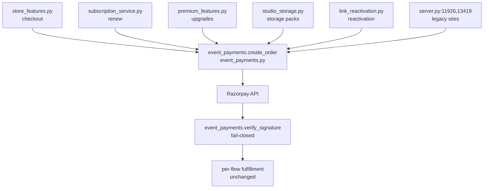

# Pathfinder Phase 3 -- Unified Proposal

Orchestrator synthesis (2026-08-11) over `02-duplication-report.md` +
`03-evidence-for-proposal.md`. Decisions below are final for Tier 1;
Tier 2 items are explicitly parked pending the owner's product call.

## Decisions

### D1. One Razorpay gateway helper (APPROVED -- do next)
All 9+ independent `order.create` / signature-verify sites consolidate onto
`backend/event_payments.py`'s `create_order()` / `verify_signature()`.
No new abstraction: each call site swaps its local try/except for the shared
call. Call sites (from report item B2): `monetization_features.py:429`,
`store_features.py:799`, `subscription_service.py:292`, `user_features.py:804`,
`link_reactivation.py:151`, `premium_features.py:989`, `server.py:11926`,
`server.py:13419`, `studio_storage.py:520`.
**Loss of capability:** none. **Why now:** money-correctness -- the bare
`except` pattern cannot distinguish forged signature from gateway outage.

### D2. One live-gallery photo store (APPROVED -- schedule with a maintenance window)
Canonical store: `db.live_photos` (richer shape: `approved`,
`favorite_count`, `favorited_by`). Plan: backfill `live_gallery_photos`
rows into `live_photos` -> repoint the guest-upload write
(`live_gallery_features.py:321`) -> delete `live_wall_feed.py`'s per-request
dual-read merge. **Loss of capability:** none; removes a permanent
2x-query tax and the write-path "remember both stores" trap
(`premium_features.py:635-657`).

### D3. Delete orphaned invitation-viewer surfaces (APPROVED)
Remove `backend/invitation_v2.py` (mounted `server.py:15686`) and
`server.py:5502` `get_event_by_slug` -- zero frontend callers in either app
(repo-wide grep). Shrinks unauthenticated attack surface.

### D4. Event-purchase engine fate (PARKED -- owner decision required)
`event_purchase_service.py` + friends form a second, complete, live money
engine reachable only from the legacy frontend's `/events` routes. Either
retire (delete routers; low effort) or port the Dynamic Event Engine UI to
frontend-v2 (multi-page build). **Do not touch until the owner decides**
whether the event engine is product scope for v2.

### D5. client_token vs user_session_token (PARKED -- owner decision required)
The Couple Access portal's `client_token` identity is only superficially
similar to the self-serve buyer cookie. Merging is a product-requirements
question (studio-issued per-wedding login vs. self-serve account), not a
cleanup. Interim hardening (allowed now): `clientAuth.js` may adopt the
timeout/retry hardening pattern from `api/client.js:44-85` without any
identity merge.

### D6. Marketing price copy (RESOLVED differently)
Faq/Landing hardcoded tier prices cannot track the admin-editable live
values by construction. Smallest correct fix when next touched: import the
figures from one shared constant in `src/lib/` and add a comment pointing
at the live source of truth (`store_features.py` PACKAGES / pricing page's
live fetch). Not urgent; copy currently self-consistent on the site.

### Already-unified (recorded, no action)
- Navigation: single `NAV_LINKS` source (`src/lib/marketingLinks.js`) feeds
  Landing nav/drawer + MarketingNav on every marketing page; studio rails
  curated to real routes only (2026-08-11 fix wave).
- Nav mechanics: RailNav family already correctly factored -- report item
  "no action needed".

## Proposed unified money path (D1)

